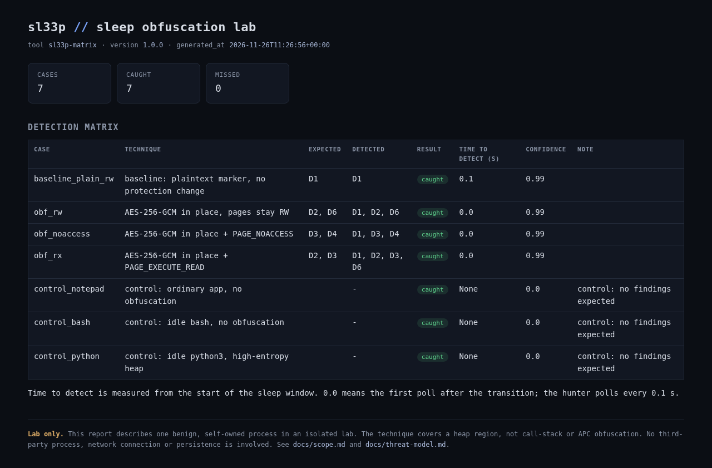
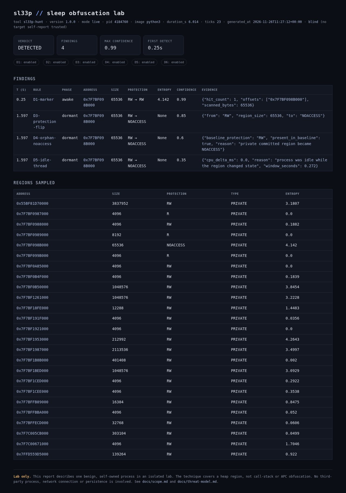

# sl33p

A lab for one behaviour: a process encrypts its own memory while it sleeps, and
a read-only detector looks for it anyway.

One process, one 64 KiB region, no injection, no network. The offensive half is
a small simulation. The detector and the measurements are what the repo is for.



## What runs today

| Part | State |
|---|---|
| Linux core (`src/core-linux`) | runs live, 7/7 matrix |
| Hunter (`src/hunt`) | live on Linux, Windows backend written |
| Windows core (`src/core`) | builds, crypto self-test passes, never run |
| Lab docs | written, not followed on a Windows VM yet |

There is no Windows VM on the machine this was built on, so the C# core has
never executed. It compiles, and `--selftest` proves the fill/seal/open path,
but that is not the same as running it.

The Linux core uses `mmap`/`mprotect` and exists so the technique and the
detector can be measured now. It is a reference build, not a replacement for
the Win32 run.

## How it works

**Core.** Allocate 64 KiB of private memory, write a marker, seal the region
with AES-256-GCM in place, change the page protection (RW, NOACCESS or RX),
wait, restore, decrypt, compare SHA-256. The marker is stored XOR-encoded and
written byte by byte, so the only plaintext copy lives inside the region.

**Hunter.** Enumerate regions, read memory read-only, then score six signals.
Every finding carries evidence and a confidence. The matrix runs it blind: a
PID and nothing else.



## Detectors

| Rule | Signal | Confidence | Blind when |
|---|---|---|---|
| D1 marker | marker bytes in a readable private region | 0.99 | encrypted or unreadable pages |
| D2 entropy | block entropy rises 2+ bits from baseline | 0.80 | pages unreadable |
| D3 protection flip | private region moves to NOACCESS/RX and back | 0.85 / 0.70 | protection never changes |
| D4 orphan NOACCESS | private NOACCESS region absent from baseline | 0.60 | pages stay RW |
| D5 idle thread | under 25 ms CPU while D3/D4 fire | 0.35 | a busy process |
| D6 key recovery | key-shaped blob decrypts the region, tag validates | 0.99 | ciphertext unreadable |

Per-region confidence is a noisy-OR of the rules that fired, capped at 0.99.
D5 is a booster and sits below the 0.6 scoring threshold on purpose.

## Run it

Python 3.12+, `cryptography`, and a .NET 10 SDK for the C# build.

```bash
python3 tools/verify.py            # tests, build, one live scenario
python3 tools/verify.py --matrix   # plus the 7-case matrix
```

Expected output:

```
[ok]   unit tests       71 tests
[ok]   core build       0 Warning(s), 0 Error(s)
[ok]   live scenario    noaccess: D3 D4, marker hidden while dormant, wake hash verified
[ok]   matrix           7/7 cases caught
PASS
```

Manual run, one scenario:

```bash
python3 src/core-linux/core_linux.py --lab-ack --mode encrypt \
    --protect noaccess --awake 2 --sleep 15 &

python3 src/hunt/sl33p_hunt.py --pid $! --duration 8 --html out.html
```

For the Windows path, read [lab/vm-setup.md](lab/vm-setup.md) and take a
snapshot before the first run. [lab/snapshots.md](lab/snapshots.md) and
[docs/kill-switch.md](docs/kill-switch.md) are short.

## Results

Linux reference harness, 26 Nov 2026:

| Case | Technique | Expected | Detected | Time to detect |
|---|---|---|---|---|
| `baseline_plain_rw` | plaintext marker | D1 | D1 | 0.1 s |
| `obf_rw` | sealed, pages stay RW | D2, D6 | D1, D2, D6 | first poll |
| `obf_noaccess` | sealed + NOACCESS | D3, D4 | D1, D3, D4 | first poll |
| `obf_rx` | sealed + RX | D2, D3 | D1, D2, D3, D6 | first poll |
| three controls | idle sleep, bash, python | none | none | n/a |

7/7 caught, 3/3 controls clean. The marker is never visible while the region is
dormant (`marker_hits_while_dormant = 0`). Detection lands on the first 100 ms
poll after the transition, which is why the number is 0.0 rather than a clock
measurement.

Full table and the defects the live runs found: [docs/results.md](docs/results.md).

## Limitations

- The Windows build has not run. Treat it as code plus a self-test.
- Masking the bytes does not hide the behaviour. `NOACCESS` still loses to
  D3/D4, which read metadata only.
- The key stays in memory while the payload is sealed. D6 finds it and decrypts
  the region. That is the interesting result, not a bug to hide.
- Linux `/proc/pid/mem` can read `PROT_NONE` pages. The hunter honours the
  protection attribute anyway, so the rule outcomes match the Windows design.
  The Python core cannot guarantee zeroisation like the C# core can.
- A payload that pages itself out would beat a RAM-only hunter. Not implemented;
  the experiment is on the list.
- False positives are real. The three controls are the minimum, not a survey.

## Layout

```
src/core/       C# core, Windows (VirtualAlloc/VirtualProtect)
src/core-linux/ Linux reference core (mmap/mprotect)
src/hunt/       detector: memory backends, entropy, rules, report
src/matrix/     cases.yml, runner, scoring
tests/          71 tests, including 3 live end-to-end
tools/          verify.py and a capture generator for replay
lab/            host setup, VM setup, snapshots, demo script
docs/           scope, threat model, kill switch, detection notes, results
report/         HTML template and generated evidence
```

## License

MIT. See [LICENSE](LICENSE). Lab only: your own isolated VM, no third-party
targets. [docs/scope.md](docs/scope.md) lists what this project does not do.
